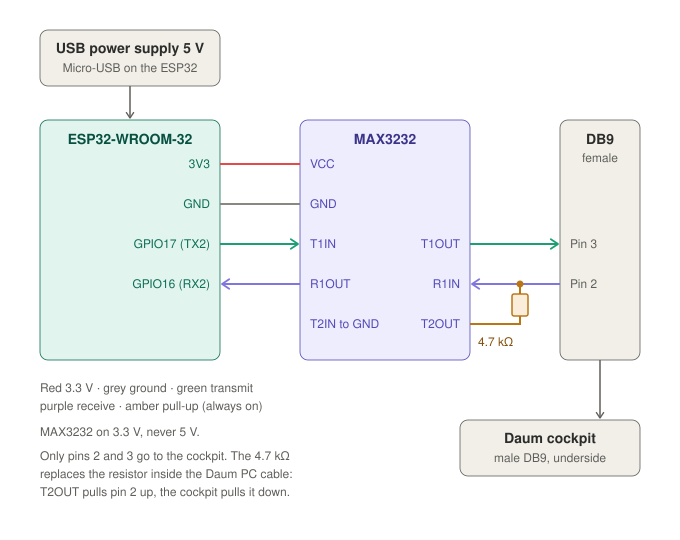

# ErgoBridge

ESP32 firmware that connects to the RS232 port of a **daum electronic ergo_bike** cockpit (developed on an
ergo_bike 8008 TRS) and offers the bike as a standard **Bluetooth LE smart trainer** (Fitness Machine
Service, FTMS). Training apps, starting with [ErgoWattControl](https://github.com/andreaskuttruff-git/ErgoWattControl)
and later Zwift, Rouvy, Kinomap, MyWhoosh or TrainerRoad, can then read power, cadence and heart rate and set
the brake power.

The Daum protocol code is a port of ErgoWattControl's tested C# implementation (address query, cockpit type
→ 400/800 W limit, free training, Set_Watt in 5 W steps, Run_Data, reply echo check, quick retries,
reconnect and re-initialisation after a cockpit reset).

## Status

| Milestone | Content | State |
|---|---|---|
| M1 | Daum protocol, self-healing bike logic, simulated cockpit, unit tests, serial console | done |
| M2 | Bluetooth LE: FTMS (ERG / target power), Cycling Power, Heart Rate, Device Information | done, not yet tried on a board |
| M3 | FTMS driver in ErgoWattControl | next |
| M4 | RS232 hardware (MAX3232) on the real cockpit | |
| M5 | Real rides, reconnect tests | |
| M6 | Simulation mode (grade → power) for Zwift & co. | |

## Bluetooth

The bridge advertises as **ErgoBridge** with these services:

| Service | Content |
|---|---|
| Fitness Machine 0x1826 | Indoor Bike Data (speed, cadence, distance, power, heart rate, time; 1 Hz), Supported Power Range (25 W … cockpit maximum, 5 W steps), Control Point: Request Control, Reset, **Set Target Power**, Start, Stop/Pause; Fitness Machine Status |
| Cycling Power 0x1818 | power and crank revolutions (for watches and apps that only read CPS) |
| Heart Rate 0x180D | the cockpit's pulse, when it has one |
| Device Information 0x180A | manufacturer, model, firmware version |
| ErgoBridge status `c7b6d000-4e2a-4f69-9a5e-2d0e8b3f1a01` | characteristic `c7b6d001-…`: version, cockpit connected, cockpit type, max. watt, target limit, target watt |

Behaviour worth knowing:
- Only the connection that sent *Request Control* may set the power; others can read.
- When the controlling app disconnects, its target is kept for 10 s (app restart), then lowered to 80 W if it was higher. *Reset* lowers it to 80 W at once.
- While the cockpit isn't pedalled, the reported power is 0 W.
- Simulation mode (grade) and resistance levels are not supported yet.

## Hardware

- ESP32 dev board (ESP32-WROOM-32 / `esp32dev`)
- MAX3232 RS232 ↔ TTL module (3.3 V): cockpit TX → MAX3232 → **GPIO16 (RX2)**, **GPIO17 (TX2)** → MAX3232 → cockpit RX, GND
- the cockpit's 9-pin PC socket is on its underside; check the cable's pinout before connecting
- 5 V USB power supply

### Wiring



| ESP32-WROOM-32 | MAX3232 module | DB9 (wired like a PC's COM port) | Purpose |
|---|---|---|---|
| 3V3 | VCC | – | supply: **3.3 V, not 5 V** – the ESP32 pins are not 5 V tolerant |
| GND | GND | pin 5 | common ground |
| GPIO17 (TX2) | TXD → T1OUT | pin 3 | ESP32 transmits to the cockpit |
| GPIO16 (RX2) | RXD ← R1IN | pin 2 | cockpit transmits to the ESP32 |

- MAX3232 modules label their TTL pins inconsistently; swapped RX/TX does no harm, there is just no answer.
- The DB9 side behaves like the PC's COM port, so the existing Daum PC cable plugs in unchanged.
- **Measure before the first connection:** with the cockpit switched on, measure the PC end of the Daum cable
  against pin 5. The pin at **−5 to −12 V** at rest is the cockpit's transmit line; it must reach R1IN (pin 2 on
  the bridge side). If it is pin 3 instead, put a null-modem adapter in between; use a gender changer if the
  connectors don't mate.
- DTR/RTS: some Daum cables draw power from them. If the cockpit doesn't answer without them, drive DTR (pin 4)
  active from a spare MAX3232 output (not drawn).
- Testing on a PC without the cockpit: leave out the MAX3232 and connect GPIO16/17 and GND straight to a 3.3 V
  USB-TTL adapter (TX to RX, RX to TX).

## Build

[PlatformIO](https://platformio.org/) (VS Code extension or `pip install platformio`):

```
pio run -e esp32-sim -t upload   # board only, built-in simulated cockpit
pio run -e esp32 -t upload       # real cockpit on UART2
pio device monitor               # 115200 baud; "w 150" sets 150 W, "s" prints the status
pio test -e native               # unit tests on the PC (needs gcc/g++ on the PATH)
```

## License

MIT, see [LICENSE](LICENSE).
